<div align="center">

# POS Automation Framework

**End-to-end test automation for a retail Point-of-Sale system:
desktop app, back-office web app and SQL Server, checked against each other.**


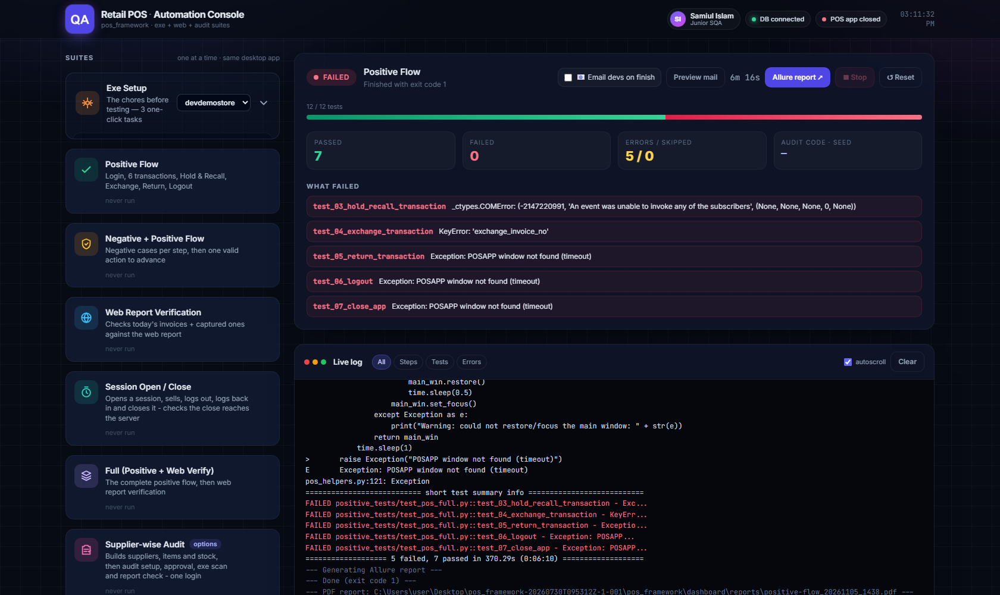

</div>

> **About this public copy.** I designed and built this framework, and I use it every day as a
> QA engineer on a commercial retail POS product. To publish it, I replaced company, client
> and product names, server addresses, credentials and customer data with placeholders
> (for example *DemoStore* and `demo-backoffice.example.com`). I also left out client bug
> reports and run output. The code, structure and techniques are exactly what runs in
> production testing.

---

## Contents

- [The problem it solves](#the-problem-it-solves)
- [What it does, at a glance](#what-it-does-at-a-glance)
- [How it works: the flows](#how-it-works-the-flows)
- [The Automation Console](#the-automation-console)
- [Test suites](#test-suites)
- [Engineering highlights](#engineering-highlights)
- [Defects it has caught](#defects-it-has-caught)
- [Project structure](#project-structure)
- [Getting started](#getting-started)
- [Continuous integration](#continuous-integration)
- [About me](#about-me)

---

## The problem it solves

A single sale in a POS system touches **three places at once**:

1. the **desktop app** the cashier uses, which shows the total, discount and VAT,
2. the **database** on the server, which stores the invoice lines, and
3. the **back-office web reports** the manager reads.

Each one can look correct on its own and still disagree with the other two. When that
happens, **money is wrong** and nobody notices until month-end.

Manual testing usually checks only the screen. **This framework checks all three, and fails
the test when they don't match.**

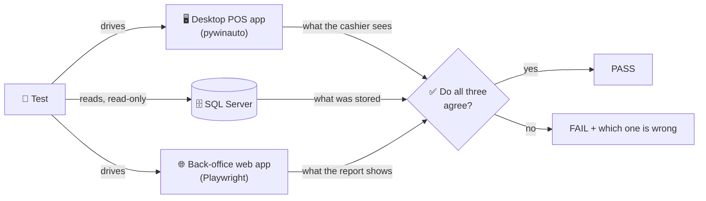

---

## What it does, at a glance

| | |
|---|---|
| 🖥️ **Desktop automation** | Drives a WinUI 3 / MSIX Windows POS app through the full cashier journey: login, sales, discounts, hold & recall, exchange, return, credit sale, session open/close, logout |
| 🌐 **Web automation** | Playwright + Page Object Model for the back office: items, customers, suppliers, employees, purchase orders, goods receipts (GRN), reports |
| 🗄️ **Database verification** | Expected values come **from SQL**, not hard-coded. Read-only by design |
| 🔁 **Cross-system checks** | Invoices created on the desktop app are found and verified in the web report |
| 📈 **Load test** | Hundreds of items sold back-to-back across customers, online and offline modes |
| 🎛️ **Automation Console** | A Flask dashboard that runs any suite with one click, streams the live log, counts pass/fail, opens Allure, builds a PDF and emails the developers |
| ⚙️ **CI/CD** | GitHub Actions: cloud checks on every push, plus a self-hosted runner for the real desktop suites |

**Scale:** ~17,800 lines of Python · 22 test modules · 86 test functions · 10 page objects ·
a 3,500-line dashboard.

---

## How it works: the flows

### 1. One test run, from click to report

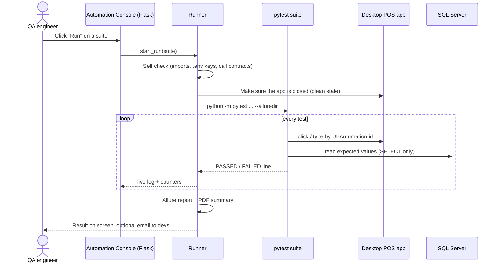

### 2. The cashier journey the Positive Flow covers

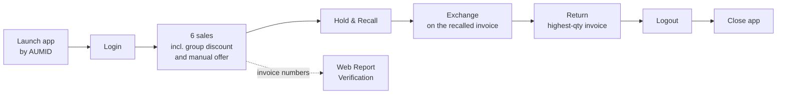

Each step hands its real output to the next step. For example, the invoice number captured
during Hold & Recall is the one Exchange uses, so nothing in the flow is a fixed test value.

### 3. Negative + Positive pattern

Every step first tries the **wrong** inputs, then performs **one valid action** so the
flow can continue:

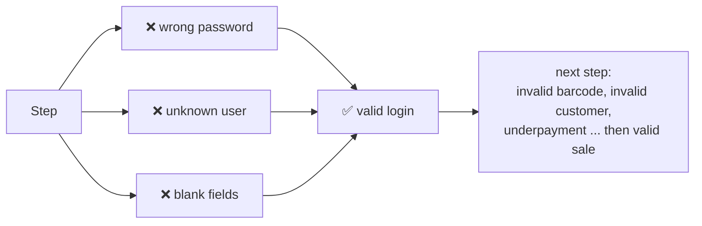

An auto-use safety fixture closes any leftover popup **before and after every test**, so one
failing case can never break the cases after it.

### 4. Supplier-wise Audit: a 9-step chain across all three systems

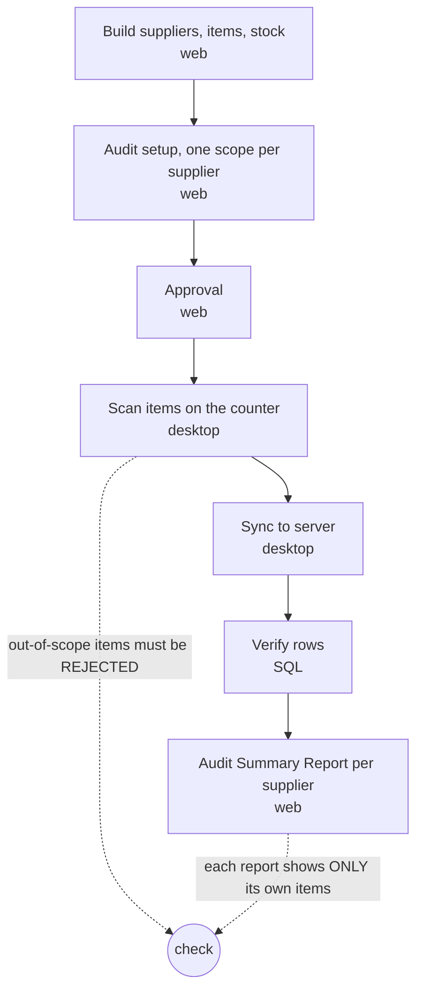

---

## The Automation Console

A local Flask app (`127.0.0.1:5055`). Anyone on the team can run any suite without
touching a terminal. Suites run one at a time, because they all drive the same desktop app.

| Starting a run | Finished run with failure summary |
|---|---|
| 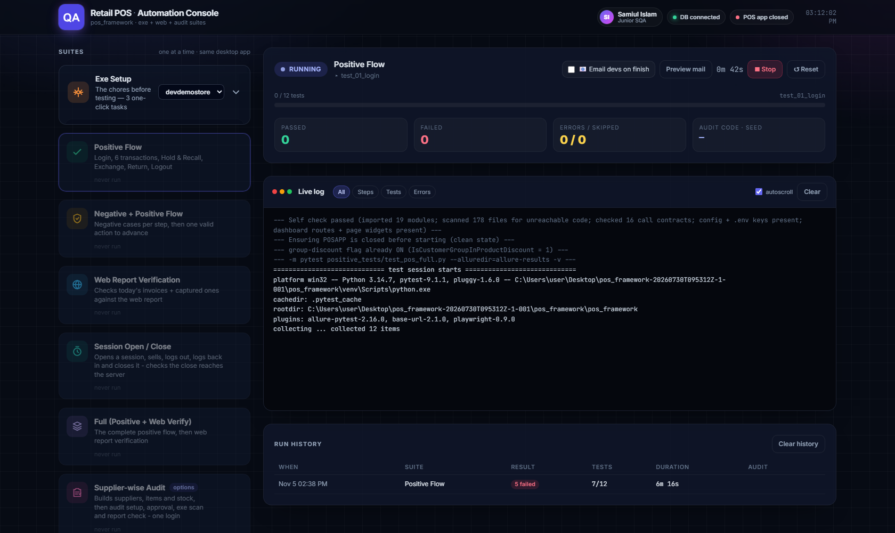 |  |
| **Load test: 4 × 30-item sales, all passed** | **Allure report for the same run** |
| 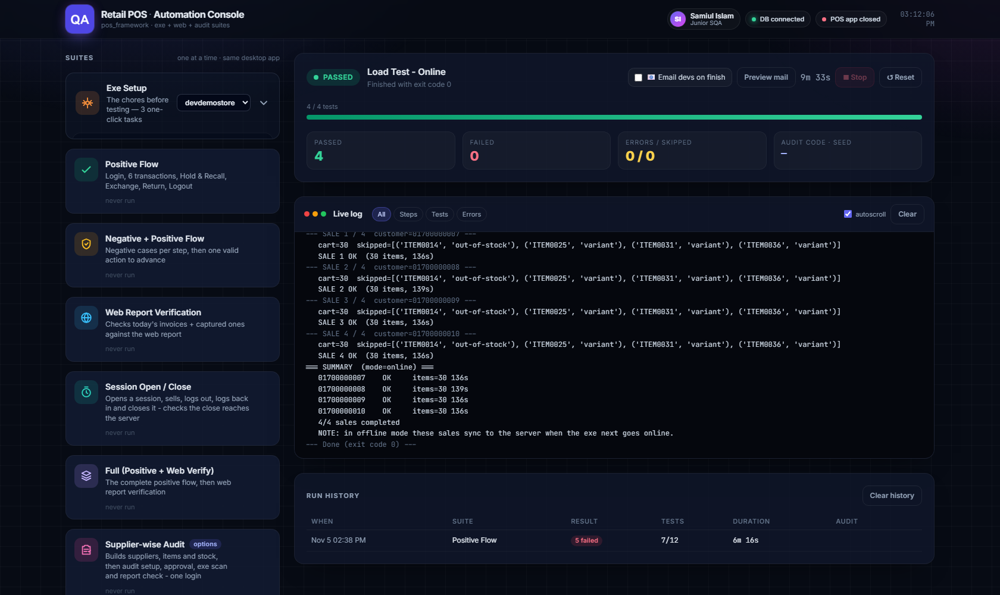 | 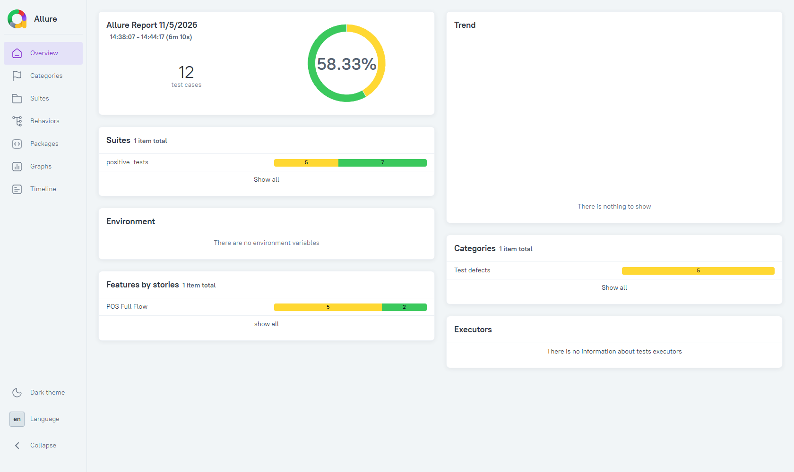 |

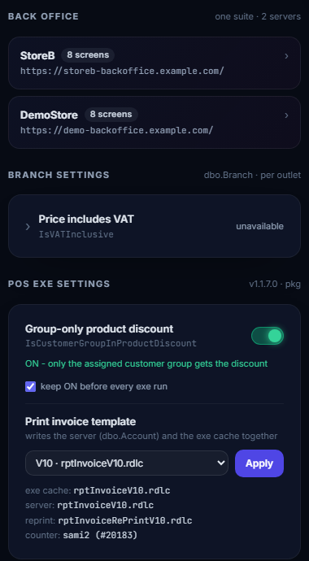

**What the console gives you:**

- **One-click suites:** Positive, Negative + Positive, Web Report Verification, Session,
  Full, Supplier-wise Audit, Load Test (online and offline), and back-office suites per
  environment.
- **Exe Setup chores:** reset the app, fetch a fresh token from the back office, register
  the counter, log in and open a session, all in one click.
- **Live log** with Steps / Tests / Errors filters and auto-scroll.
- **Pass / fail tiles** that always agree with the test list. They are re-counted from
  Allure at the end of a run, because desktop UI-Automation noise can split pytest's
  verdict lines.
- **"What failed"**, showing the first assertion line of every failed test.
- **Allure report** per suite, plus a **PDF summary** that can be **emailed to developers**
  automatically.
- **Settings panel (right):** toggle app flags and switch invoice templates (written to the
  server and the app's local cache together), and branch VAT settings, all without opening
  SQL.
- **Self check before every run:** imports every module, scans for unreachable code, verifies
  call contracts, `.env` keys and dashboard routes.

<br clear="right">

---

## Test suites

### Desktop POS (pywinauto)

| Suite | What it proves |
|---|---|
| **Positive Flow** | The full happy path: login → 6 transactions → hold & recall → exchange → return → logout → close |
| **Negative + Positive Flow** | 24 cases covering:<br>• rejected logins<br>• invalid barcode or customer<br>• underpayment<br>• customer-group discount (applied for the group, withheld for others, scaling with quantity, surviving a customer switch, stacking with a manual offer, surviving hold & recall)<br>• hold & recall edge cases<br>• return-quantity validation |
| **Session Open / Close** | Opens a session, sells, logs out, logs back in, closes it, then checks that the close **actually reached the server** |
| **Credit Sales** | Create a credit customer → verify in SQL → collection before → credit sale → invoice flagged as credit → collection after |
| **Supplier-wise Audit** | The 9-step chain above, with seed-based replay so any run can be reproduced exactly |
| **Load Test** | N customers × M items per sale. Handles out-of-stock and variant popups, verifies the cart after every add |

### Back office (Playwright)

- **Page Object Model** with a base page and one page object per screen.
- **Profile registry:** each environment is one file in `backoffice/profiles/`. Adding a
  profile automatically gives the console a new suite, with no dashboard change.
- **Coverage:** item, customer, supplier, employee and partner creation, language
  configuration, purchase orders, multi-item GRN, GRN amount discrepancies, and
  stored-total agreement.
- **Test design artefacts:** test cases in Markdown and CSV, plus a knowledge base of the
  purchase module's business rules.

### Cross-system

**Web Report Verification** reads the invoices the desktop suite just created and finds each
one in the back-office report. This catches the class of bug where a sale looks right on the
counter but wrong in the office.

---

## Engineering highlights

The hard part of this project was getting a **modern packaged Windows app** to behave like a
testable system. These are the decisions that made it reliable.

- **No hard-coded launch path.** MSIX apps change identity on every rebuild, so the app's
  AUMID is resolved at launch time from `Get-StartApps`.
- **No coordinates, no image matching.** Every control is addressed by its UI Automation
  `auto_id`. That survives window moves, DPI changes and themes.
- **True clean state.** `Reset-AppxPackage` factory-resets the app, so a defect can be
  reproduced down to a single variable.
- **Polling instead of sleeping.** A cold start takes about 17 seconds and varies, so every
  wait is a poll with a timeout.
- **Defensive clicking.** A minimised window is restored first, otherwise popups render
  off-screen and look like "the button never appeared". Stubborn buttons are tried with four
  different press strategies.
- **Reading the app's own data.** The app keeps SQLite databases in its sandbox. Reading a
  copy of them is how the "session close never reaches the server" defect was proven: the
  local row said *closed*, the server said *open*.
- **Expected values come from the database.** A test never types its own expected total. It
  reads it from SQL, or creates the data through the back office so the arithmetic is known.
- **Safety by design.**
  - The SQL helper only allows read queries.
  - Credentials live only in `.env`.
  - A pre-commit hook and the CI both scan for leaked secrets.
- **Tooling reliability.** The dashboard copes with real-world output quirks. For example, a
  harmless COM warning (`0x8001010d`) can split pytest's `PASSED` line onto another line, so
  results are re-counted from Allure.

Full write-up of the desktop side, including the control map and every trap that cost a
failed run: **[docs/DESKTOP_AUTOMATION.md](docs/DESKTOP_AUTOMATION.md)**

---

## Defects it has caught

Real issues found with this framework on the product. Details are anonymized, and each one was
delivered to developers as a PDF with root cause, reproduction steps and SQL evidence.

| Area | What was wrong (root cause) |
|---|---|
| **Session close** | The app marked a session *closed* locally without checking the server's reply, so most sessions stayed open on the server forever |
| **Purchase VAT** | A requisition line with 0% VAT became 15% when received. A *falsy-zero* bug: `0` was treated as "not set" |
| **GRN totals** | The same goods receipt showed two different payable amounts. The server rebuilt one total from the rows but trusted the browser for another |
| **Selling price** | Receiving a purchase order could overwrite an item's selling price with 0. There was no zero guard |
| **Sales report** | Customers without a territory were silently excluded, hiding a large share of sales value |
| **Bulk upload** | A "date is in the future" error between midnight and 6 AM: the server compared dates in UTC instead of local time |
| **Accounting journals** | "Too many auto-posted journals per day" traced to correct per-credit-sale postings with a misleading narration, not double posting |

---

## Project structure

```
.
├── .github/workflows/        CI: cloud checks + self-hosted suite runner
├── .githooks/pre-commit      blocks commits that contain credentials
├── docs/
│   ├── DESKTOP_AUTOMATION.md how the desktop app is driven, in depth
│   └── screenshots/
└── pos_framework/
    ├── dashboard/            Flask Automation Console
    │   ├── app.py            routes / API
    │   ├── runner.py         runs suites, parses live output, history
    │   ├── reporter.py       PDF summary
    │   ├── mailer.py         email to developers
    │   └── templates/ static/
    └── pos_framework/
        ├── pos_actions.py    business actions on the desktop app (sale, hold, return ...)
        ├── pos_helpers.py    generic desktop automation (launch, find, click, popups)
        ├── web_helpers.py    generic browser helpers
        ├── db_helpers.py     read-only SQL access
        ├── config.py         test data and settings (secrets come from .env)
        ├── positive_tests/   happy path + web report verification
        ├── negative_tests/   negative cases per step + popup safety fixture
        ├── session_tests/    session open/close + standalone reproduction
        ├── credit_tests/     credit sales and collection
        ├── audit_tests/      supplier-wise audit, end to end
        ├── exe_setup/        one-click setup chores
        ├── backoffice/       Playwright framework (pages, profiles, tests, knowledge)
        ├── tools/            self check, test-data validator
        ├── report-builder/   HTML → PDF for bug reports
        └── load_test.py      volume test, online/offline
```

---

## Getting started

> This framework targets a specific Windows POS application. To run it you need that app (or
> your own, after adapting the control map) and a test database. The code is published to show
> the design and techniques.

**Requirements:**
- Windows 11 with an interactive desktop session
- Python 3.11+
- ODBC Driver 18 for SQL Server
- Allure CLI

```bash
git clone https://github.com/samiul501/pos-automation-framework.git
cd pos-automation-framework

python -m venv pos_framework/venv
pos_framework/venv/Scripts/python -m pip install -r pos_framework/pos_framework/requirements.txt
pos_framework/venv/Scripts/python -m pip install -r pos_framework/dashboard/requirements.txt
pos_framework/venv/Scripts/python -m playwright install chromium

git config core.hooksPath .githooks                       # secret scan on every commit
cp pos_framework/pos_framework/.env.example pos_framework/pos_framework/.env   # fill in your values
```

**Run the console:**

```bash
pos_framework/venv/Scripts/python pos_framework/dashboard/app.py
# open http://127.0.0.1:5055
```

**Or run suites directly:**

```bash
cd pos_framework/pos_framework
../venv/Scripts/python -m pytest positive_tests/test_pos_full.py -v
../venv/Scripts/python -m pytest negative_tests/test_negative_positive_flow.py -v
../venv/Scripts/python -m pytest backoffice -c backoffice/pytest.ini --app demostore
../venv/Scripts/python load_test.py --mode online --customers 4 --items 30
```

---

## Continuous integration

GitHub's cloud runners have no desktop session and no route to internal servers, so CI runs
in two layers:

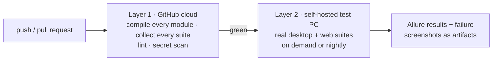

The self-hosted runner has to run as a **startup task of the logged-in user**, not as a
Windows service. A service runs in session 0, which has no desktop, so every UI test would
fail with "window not found".

---

## About me

**Samiul Islam**, QA Automation Engineer

I built this framework end to end: the desktop and web automation, the database checks, the
dashboard, the CI and the reporting. I used it daily to find, prove and report real defects.

- **Skills shown here:**
  - Python and pytest
  - pywinauto (UI Automation)
  - Playwright
  - SQL Server
  - Flask
  - Allure
  - GitHub Actions
  - test design (positive, negative, edge, load)
  - root-cause analysis
- **GitHub:** [@samiul501](https://github.com/samiul501)
